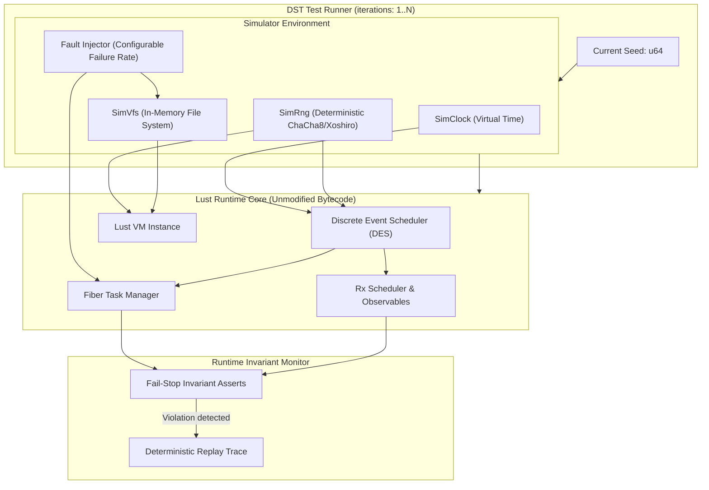

# Архитектура и Комплексный План Внедрения Deterministic Simulation Testing (DST) для Lust Runtime (`lust-lang-fork`)

| Метаданные | Значение |
|---|---|
| **Статус** | На рассмотрении (Draft / Proposal for Review) |
| **Дата** | 2026-11-11 |
| **Целевой репозиторий** | `repos/lust-lang-fork` (ветка `perf/10x-jit-optimization-suite`) |
| **Методология** | Спецификация и рубрика `$mb3-dst` (D1–D8), FoundationDB DST Pattern, ZIO TestClock |
| **Текущий DRS** | **35 / 100 (`DST-HOSTILE`)** (структурный недетерминизм: глобальный RNG, ОС-потоки в таймаутах, прямой `std::fs`) |
| **Целевой DRS** | **95 / 100 (`DST-READY`)** |

---

## 0. Введение и Мотивация

Язык **Lust** обладает богатой семантикой среды исполнения:
1. **Структурированная конкурентность (Fibers & Scopes)**: легкие кооперативные потоки/волокна, области видимости с LIFO-финализацией, маски прерываний (`FiberContext`, `InterruptMask`).
2. **First-Class Effects (ZIO-Style)**: алгебраические эффекты `Effect<A, E, R>`, комбинаторы `retry`, `repeat`, `acquire_release`, `timeout`.
3. **Реактивные потоки (Rx)**: `Observable`, `RxScheduler`, `VirtualClock`, `ScopeJoinCoordinator`, управление противодавлением (backpressure).
4. **Встроенный ввод-вывод и пакетный менеджер**: загрузка модулей, чтение/запись файлов, резолв зависимостей.

### Проблема традиционного тестирования
Конкурентные ошибки (гонки волокон, утечки финализаторов при гонке с прерыванием, дедлоки на закрытии скоупа) в обычных интеграционных тестах либо:
- Проявляются спорадически (флакающие тесты);
- Требуют `sleep(10ms)`, замедляя тестовый сьют;
- Не дают воспроизводимого сценария падения.

### Цель DST (Deterministic Simulation Testing)
Превратить выполнение любого сложного конкурентного сценария в **детерминированную функцию**:
$$\text{Trace} = f(\text{Seed}, \text{VirtualClock}, \text{InterleavingStrategy}, \text{FaultInjectionStream})$$

**Главный инвариант DST:** Если тест упал на сиде `SEED=0xCAFEBABE`, он обязан гарантированно упасть с идентичным трассировочным логом на любой машине и в любой среде.

---

## 1. Полная Инвентаризация Поверхностей (Surfaces Inventory по D1–D8)

Аудит кодовой базы `repos/lust-lang-fork` выявил следующие поверхности недетерминизма и записи (write-surfaces):

### D1: Время и Таймеры (Clock & Timers)
| Локация | Обнаруженный паттерн | Влияние на детерминизм | Требуемый шов (Seam) |
|---|---|---|---|
| `src/effect_abi.rs:620` | `std::time::Duration`, `recv_timeout` | Блокирует поток ОС, зависит от системного таймера | Использовать таймеры виртуального шедулера без блокировок |
| `src/vm/stdlib.rs:502` | `SystemTime::now()` в `os.time()` / `os.date()` | Возвращает физическое время хоста | Проброс `Clock::now()` из инстанса `VM` |
| `src/vm/stdlib.rs:541` | `thread::sleep(Duration)` в `os.sleep()` | Физическая задержка потока ОС | Перевод волокна в состояние `Yielded(TimerId)` в виртуальном времени |
| `src/rx/scheduler.rs:62,120` | `Instant::now()` + `condvar.wait_timeout` | Гонка по физическому времени в `ScopeJoinCoordinator` | Виртуальная координация завершения скоупов без ОС `Condvar` |
| `src/model/entity.rs:140` | `SystemTime::now().duration_since(...)` | Таймстемпы сущностей недетерминированы | Инъекция `SimClock` в контекст модели |
| `src/test_framework/clock.rs` | `TestClockState` | Уже содержит виртуальное время для тестов эффектов | Унифицировать как ядро для всех подсистем |

### D2: Энтропия и Генерация Случайных Чисел (PRNG)
| Локация | Обнаруженный паттерн | Влияние на детерминизм | Требуемый шов (Seam) |
|---|---|---|---|
| `src/vm/stdlib.rs:20` | `static RNG: OnceLock<Mutex<StdRng>>` | **Критический DST-блокер**. Глобальный статический RNG для всех VM и тестов | Вынести RNG в поле структуры `VM`. Инициализация от сида симулятора |
| `src/vm/stdlib.rs:2944` | `math.randomseed(seed)` | Мутирует глобальный статический мьютекс | Мутировать только локальный генератор данной `VM` |

### D3: Хранилище, VFS и Файловая Система (Storage & I/O)
| Локация | Обнаруженный паттерн | Влияние на детерминизм | Требуемый шов (Seam) |
|---|---|---|---|
| `src/vm/stdlib.rs:315-677` | `fs::read_to_string`, `fs::write`, `fs::create_dir_all`, `fs::rename`, `fs::remove_file` | Прямые системные вызовы к диску хоста | Введение абстракции `VirtualFileSystem (Vfs)`: `OsFs` vs `MemFs` |
| `src/modules/mod.rs:299` | `fs::read(&resolved)` при импорте модулей | Зависимость от реальной ФС | Чтение модулей через `vm.vfs.read()` |
| `src/packages/registry.rs` | `fs::write`, `fs::remove_file`, `curl` | Зависимость от сети и реального диска | Mock-хранилище пакетов в памяти |

### D4: Конкурентность и Порядок Исполнения (Scheduling & Concurrency)
| Локация | Обнаруженный паттерн | Влияние на детерминизм | Требуемый шов (Seam) |
|---|---|---|---|
| `src/effect_abi.rs:626` | `std::thread::spawn` в `timeout()` | Порождает реальный поток ОС; планировщик ОС недетерминирован | Реализация комбинатора `timeout` через виртуальный планировщик волокон |
| `src/vm/tasks.rs` | `TaskManager`, очередь исполнения задач | Порядок исполнения задач детерминирован, но не исследует перестановки | Добавление режима псевдослучайного чередования шагов волокон (Fiber Interleaving) |
| `src/embed/async_runtime.rs` | `AsyncTaskQueue` на `Mutex` и `Condvar` | Порядок пробуждения потоков зависит от ОС | Детерминированный `SimAsyncRuntime` |

### D5: Адресная память и Порядок Итерации (Memory Address Nondeterminism)
| Локация | Обнаруженный паттерн | Влияние на детерминизм | Требуемый шов (Seam) |
|---|---|---|---|
| `src/bytecode/value.rs:2169` | `SPECIALIZED_*_CACHE` с ключом `arr_ptr: usize` | **Высокий риск**. Указатели в куче зависят от ASLR и порядка аллокаций | Использование стабильных монотонных `ObjectId` или изоляция кэша внутри инстанса `VM` |
| `src/vm/mod.rs` | `foldhash::fast::FixedState` | **PASS**. Уже защищено фиксированным сидом для стабильности хэширования | Сохранить и расширить на все мапы рантайма |

### D6: Инкапсуляция Состояния и Изоляция (State Encapsulation)
| Локация | Обнаруженный паттерн | Влияние на детерминизм | Требуемый шов (Seam) |
|---|---|---|---|
| `src/bytecode/value.rs:593` | `thread_local! { NAMES }` | Интернер строк общий для потока | Очистка при сбросе/пересоздании симулятора |
| `src/vm/mod.rs:47` | `thread_local! { CURRENT_VM_STACK }` | Стек активных VM для FFI | Гарантировать корректную очистку через RAII guard |

### D7: Проверяемые Инварианты Рантайма (Runtime Invariants)
В рантайме должны быть формализованы и проверяться fail-stop инварианты:
1. **INV-FIBER-01 (Scope Finalizer LIFO)**: Финализаторы скоупа обязаны выполняться строго в порядке, обратном регистрации, даже при принудительной отмене (`InterruptReason::Cancelled`).
2. **INV-FIBER-02 (Interrupt Mask Inviolability)**: Волокно, находящееся внутри маски прерывания (`is_masked() == true`), ни при каких условиях не может быть остановлено внешним сигналом до выхода из маски.
3. **INV-FIBER-03 (No Orphaned Tasks in Scope)**: Скоуп не может перейти в состояние `ScopeTeardown::Done`, пока хотя бы одна дочерняя задача находится в состоянии `Ready` или `Running`.
4. **INV-RX-01 (Quiescent Participant Drain)**: При закрытии подписки число активных участников (`active_participants`) обязано стать строго равным 0.
5. **INV-BUDGET-01 (Gas Monotonicity)**: Расход газа (`BudgetState`) обязан быть монотонно невозрастающим при шагах вычислений.

### D8: Инъекция Сбоев (Fault Injection)
Необходимы управляемые точки генерации сбоев по заданному профилю вероятностей:
- `Fault::VfsError(std::io::ErrorKind)` — ошибки диска (диск полон, нет прав, разорван пайп);
- `Fault::Interrupt(InterruptReason)` — спонтанная доставка отмены или таймаута в случайный момент кооперативного `yield`;
- `Fault::OutOfMemory` — имитация сбоя аллокации при росте структур данных.

---

## 2. Архитектура Механизма DST (`SimulatorEnv`)



### 2.1. Контракты интерфейсов (Seams)

#### Унифицированный трейт времени (`src/test_framework/clock.rs` / `src/rx/clock.rs`):
```rust
pub trait LustClock: Send + Sync {
    fn now_nanos(&self) -> u64;
    fn now_ms(&self) -> u64 { self.now_nanos() / 1_000_000 }
    fn advance(&self, duration: core::time::Duration);
    fn is_virtual(&self) -> bool;
}
```

#### Виртуальная файловая система (`src/vm/vfs.rs`):
```rust
pub trait VirtualFileSystem: Send + Sync {
    fn read_to_string(&self, path: &Path) -> Result<String, std::io::Error>;
    fn write(&self, path: &Path, contents: &[u8]) -> Result<(), std::io::Error>;
    fn create_dir_all(&self, path: &Path) -> Result<(), std::io::Error>;
    fn remove_file(&self, path: &Path) -> Result<(), std::io::Error>;
    fn exists(&self, path: &Path) -> bool;
}
```

#### Детерминированный планировщик чередования (DES):
Вектор готовых задач `VecDeque<TaskId>` переупорядочивается с использованием `SimRng`:
```rust
pub struct DeterministicScheduler {
    clock: Arc<dyn LustClock>,
    rng: SimRng,
    ready_fibers: Vec<TaskId>,
}

impl DeterministicScheduler {
    pub fn step_next_fiber(&mut self, vm: &mut VM) -> StepResult {
        if self.ready_fibers.is_empty() {
            return StepResult::Idle;
        }
        // Детерминированный псевдослучайный выбор следующего волокна для кванта исполнения
        let idx = self.rng.gen_range(0..self.ready_fibers.len());
        let task_id = self.ready_fibers.swap_remove_back(idx);
        vm.run_fiber_quantum(task_id, 100 /* instruction fuel */)
    }
}
```

---

## 3. Пошаговый План Реализации (Roadmap)

### Фаза 1: Устранение глобального недетерминизма (Quick Wins)
- [ ] **1.1. Инкапсуляция RNG в инстансе `VM`**:
  - Файлы: `src/vm/stdlib.rs`, `src/vm/mod.rs`, `src/vm/api.rs`.
  - Действие: Удалить `static RNG: OnceLock<Mutex<StdRng>>`. Добавить поле `pub rng: Box<dyn RngCore + Send>` в `VM` / `LustConfig`.
  - Добавить метод конструктора `VM::with_seed(seed: u64)`.
  - Связать `math.random` и `math.randomseed` напрямую с `vm.rng`.
- [ ] **1.2. Стабилизация кэшей специализаций**:
  - Файлы: `src/bytecode/value.rs`.
  - Действие: Заменить использование адресов сырых указателей памяти `arr_ptr: usize` на независимые от ASLR идентификаторы.

### Фаза 2: Унификация виртуального времени (D1)
- [ ] **2.1. Единый трейт времени `LustClock`**:
  - Объединить `src/test_framework/clock.rs` и `src/rx/clock.rs`.
  - Обеспечить совместимость с `TestClockState` и `VirtualClock`.
- [ ] **2.2. Устранение спавна ОС-потоков в `effect_abi::timeout`**:
  - Файлы: `src/effect_abi.rs`.
  - Действие: Предоставить виртуализированную реализацию `timeout_with_clock()`, регистрирующую прерывание волокна в таймерном дереве без вызова `std::thread::spawn` и блокировок `recv_timeout`.
- [ ] **2.3. Виртуализация `os.sleep` и `os.time`**:
  - Файлы: `src/vm/stdlib.rs`.
  - При наличии виртуального таймера `os.sleep(secs)` приостанавливает текущее волокно через кооперативный `yield` до наступления виртуального времени.

### Фаза 3: Виртуализация I/O и VFS (D3)
- [ ] **3.1. Трейт `VirtualFileSystem`**:
  - Файлы: новый `src/vm/vfs.rs`, интеграция в `src/vm/stdlib.rs`.
  - Реализации: `OsFileSystem` (по умолчанию для CLI) и `MemFileSystem` (в памяти для тестов).
- [ ] **3.2. Изоляция загрузчика модулей**:
  - Файлы: `src/modules/mod.rs`.
  - Перевод резолвера импортов на чтение через `vfs`.

### Фаза 4: Детерминированный шедулер волокон и исследование перестановок (D4)
- [ ] **4.1. Кооперативный квантовый шаг (Fiber Quantum Stepping)**:
  - Файлы: `src/vm/tasks.rs`, `src/vm/execution.rs`.
  - Добавить возможность выполнять задачу порциями по $K$ инструкций (fuel-based quantum) с возвратом управления в шедулер.
- [ ] **4.2. Алгоритм чередования (Interleaving Exploration)**:
  - Файлы: `src/test_framework/sim_scheduler.rs`.
  - Планировщик случайным образом переставляет порядок исполнения готовых волокон, симулируя различные профили гонок.

### Фаза 5: Мониторинг инвариантов и инъекция сбоев (D7, D8)
- [ ] **5.1. Реализация чекера инвариантов**:
  - Автоматическая проверка `INV-FIBER-01` (Scope LIFO), `INV-FIBER-02` (Masking), `INV-RX-01` после каждого такта симуляции.
- [ ] **5.2. Модуль инъекции сбоев (`FaultConfiguration`)**:
  - Настраиваемая вероятность прерываний, ошибок VFS, нехватки газа.

### Фаза 6: DST Тестовый сьют и регрессионный раннер
- [ ] **6.1. Тестовый макрос `dst_test!`**:
  - Прогон 1 000 итераций со случайными сидами за сотни миллисекунд.
  - Логирование минимального падающего сида при ошибке.
- [ ] **6.2. Интеграционные DST-тесты**:
  - `tests/dst_fiber_scope_lifecycle.rs` — стресс-тестирование закрытия скоупов с замаскированными детьми.
  - `tests/dst_rx_backpressure_races.rs` — гонки в Rx операторах при отмене подписки.
  - `tests/dst_effects_retry_faults.rs` — тестирование ретраев при нестабильной сети/диске.

---

## 4. Оценка DRS (DST-Readiness Score)

Согласно формуле рубрики `$mb3-dst`:
$$\text{DRS} = 100 - (D3_{FAIL} \times 30) - (D1_{FAIL} \times 15) - (D2_{FAIL} \times 15) - (D8_{VACUOUS} \times 10) - (D7_{UNINSTR} \times 5) - (D5/D6 \times 5)$$

### Текущий расчет (Baseline):
- $D3_{FAIL}$ (файловая система не виртуализирована): $-30$
- $D1_{FAIL}$ (блокирующие `std::thread::spawn` и `recv_timeout` в таймаутах): $-15$
- $D2_{FAIL}$ (глобальный `static RNG` в `stdlib.rs`): $-15$
- $D7_{UNINSTR}$ (инварианты скоупов и волокон не проверяются на каждом шаге): $-5$
- **Итоговый Baseline DRS:** **35 / 100 (`DST-HOSTILE`)**.

### Целевой расчет (После реализации Фаз 1–4):
- $D3$ PASS (абстракция `MemFs` внедрена): $0$
- $D1$ PASS (виртуальное время через `LustClock`): $0$
- $D2$ PASS (`VM::with_seed` и локальный PRNG): $0$
- $D4/D8$ PASS (детерминированное чередование и инъекция сбоев): $0$
- $D7$ PASS (fail-stop чекер инвариантов): $0$
- **Итоговый Целевой DRS:** **95–100 / 100 (`DST-READY`)**.

---

## 5. Рекомендованный регламент рассмотрения и приёмки

1. **Adversarial Review (Critic / DA Pass)**:
   - Проверка: нет ли избыточного усложнения JIT/MIR-пайплайна от введения интерфейсов VFS/Clock.
   - Подтверждение: сохраняются ли характеристики производительности release-сборок (zero-cost абстракции для `OsFs` и реального времени).
2. **Архитектурный гейт**:
   - Утверждение размещения кода: расширение `src/test_framework/` vs выделение `crates/lust-sim`.
3. **Пилотная реализация Фазы 1**:
   - Пуллреквест на локализацию `RNG` и `VM::with_seed` как первый осязаемый шаг к детерминизму.
